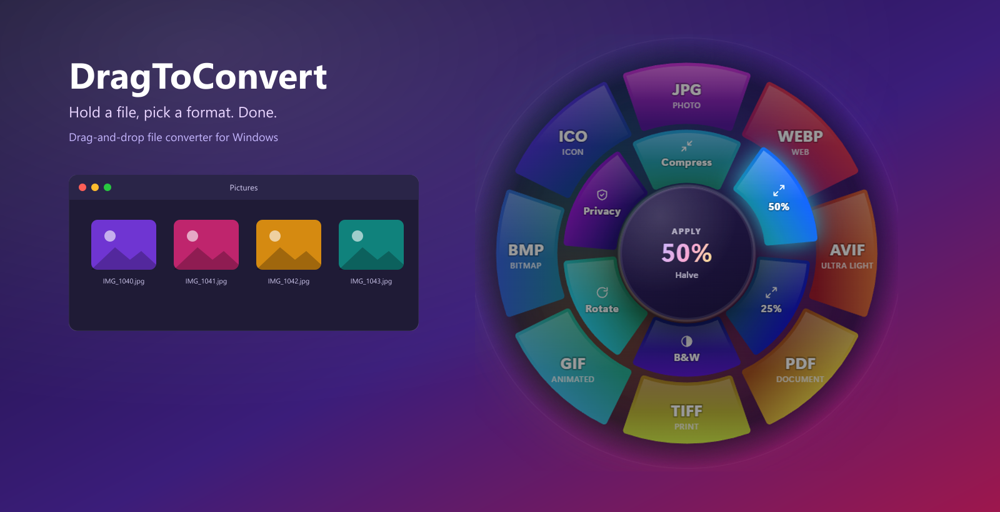

<div align="center">



# DragToConvert

**Trascina un file. Rilascialo su un formato. Fatto.**

Una piccola app per la tray di Windows che trasforma ogni trascinamento in Esplora file in una conversione.
Niente finestre da aprire, niente menu, niente upload: tutto avviene in locale.

[](https://github.com/Kind3rin/DragToConvert/releases/latest)
[](LICENSE)


[**Scarica**](https://github.com/Kind3rin/DragToConvert/releases/latest) · [Come funziona](docs/HOW-IT-WORKS.md) · [English](README.md)

</div>

---

## Come si usa

1. Inizia a trascinare un file in Esplora file (o sul desktop) tenendo premuto **Shift**.
2. Attorno al cursore si apre una **ruota**:
   - l'**anello esterno** contiene i **formati** di destinazione,
   - l'**anello interno** contiene gli **strumenti** rapidi (comprimi, ridimensiona, rimuovi metadati...).
3. Rilascia il file su uno spicchio. Una barra circolare mostra l'avanzamento e compare la spunta verde.
4. Il nuovo file viene salvato **accanto all'originale**, che non viene mai toccato.

Non vuoi usare Shift? Dal menu della tray scegli *Solo trascina*: la ruota compare quando ti fermi un istante durante il trascinamento.

<table>
  <tr>
    <td align="center"></td>
    <td align="center"></td>
  </tr>
</table>

## Installazione

**Il modo facile**

1. Scarica `DragToConvert Setup x.y.z.exe` dall'[ultima release](https://github.com/Kind3rin/DragToConvert/releases/latest).
2. Eseguilo: si installa per l'utente corrente, **senza permessi di amministratore**, e parte subito.
3. Cerca l'icona a ruota nell'area di notifica (potrebbe essere dietro la freccia `^`).

> SmartScreen può segnalare un'app non riconosciuta perché l'installer non è ancora firmato.
> Clicca **Maggiori informazioni → Esegui comunque**. Tutto il codice è in questo repository, puoi controllarlo o compilarlo da solo.

Per l'avvio automatico: clic destro sull'icona nella tray e attiva **Avvia con Windows**.

**Da sorgente**

```bash
git clone https://github.com/Kind3rin/DragToConvert.git
cd DragToConvert
npm install
npm start
```

Serve [Node.js](https://nodejs.org) 20 o successivo. Per creare l'installer: `npm run dist` (in `dist/`).

## Cosa converte

| Trascini | Anello formati | Anello strumenti |
| --- | --- | --- |
| **Immagini**<br/>JPG, PNG, WEBP, AVIF, GIF, TIFF, BMP, ICO, SVG, HEIC/HEIF | JPG, PNG, WEBP, AVIF, PDF, TIFF, GIF, BMP, ICO | Comprimi, 50%, 25%, bianco e nero, ruota, rimuovi EXIF |
| **Video**<br/>MP4, MOV, MKV, WEBM, AVI, M4V, WMV, FLV, MPEG, 3GP | MP4, WEBM, GIF, MOV, MKV, MP3 (solo audio) | Comprimi, 720p, 480p, muto |
| **Audio**<br/>MP3, WAV, FLAC, OGG, M4A, AAC, OPUS, WMA | MP3, WAV, FLAC, OGG, M4A, OPUS | Comprimi (MP3 128k), normalizza volume, mono |

- Puoi trascinare **più file insieme**: vengono convertiti in sequenza.
- GIF e WEBP animati restano animati.
- Le immagini trasparenti salvate in JPG vengono appiattite su bianco.
- Nessun file viene sovrascritto: `foto.webp`, poi `foto (1).webp`. Gli strumenti aggiungono un suffisso, es. `foto (compresso).jpg`.
- Clicca la spunta verde per mostrare il risultato in Esplora file.

## Impostazioni (clic destro sull'icona nella tray)

| Voce | Cosa fa |
| --- | --- |
| **Attivo** | Mette in pausa l'app senza chiuderla |
| **Come far comparire la ruota** | *Shift + trascina* (predefinito) o *Solo trascina (fermati un istante)* |
| **Funziona anche fuori da Esplora file** | Di default la ruota compare solo per trascinamenti che iniziano in Esplora file o sul desktop |
| **Avvia con Windows** | Avvio automatico (versione installata) |

La lingua segue quella di Windows (italiano o inglese). Per forzarla aggiungi `"language": "it"` o `"en"` a `%APPDATA%\DragToConvert\settings.json`.

## Domande frequenti

**È sicuro? Carica i miei file?**
Tutto viene elaborato in locale, niente esce dal PC e l'app non fa richieste di rete. Il file originale non viene mai spostato, modificato o eliminato: il rilascio esegue sempre una *copia*.

**La ruota non compare.**
Controlla che il trascinamento parta da Esplora file o dal desktop, oppure attiva *Funziona anche fuori da Esplora file*. Le app eseguite come amministratore non sono osservabili da un'app normale: in quel caso avvia anche DragToConvert come amministratore.

**L'antivirus lo segnala. Perché?**
Per accorgersi dell'inizio di un trascinamento serve un hook globale del mouse, tecnica usata anche dai keylogger: alcuni antivirus sono sospettosi verso le app non firmate che la usano. Il codice è aperto (l'hook legge solo stato dei pulsanti, movimento e Shift: vedi [SECURITY.md](SECURITY.md)). Ogni release include `SHA256SUMS.txt` per verificare il download (`Get-FileHash "DragToConvert Setup x.y.z.exe"`) e puoi sempre compilare l'installer da solo.

**Shift + trascina in Esplora file di solito sposta i file, no?**
Sì, per questo la ruota è solo una destinazione di rilascio: se rilasci il file altrove, Windows si comporta come sempre.

## Roadmap

HEIC/JXL in uscita · PDF → immagini e unione in PDF multipagina · preset di qualità · installer firmato e pacchetto `winget` · altre lingue.
Idee e pull request sono benvenute: vedi [CONTRIBUTING.md](CONTRIBUTING.md).

## Sviluppo

```bash
npm start                      # avvia l'app (resta nella tray)
npm run demo                   # mostra la ruota senza trascinare (--hover=N --mime=video/mp4 --state=busy|done --lang=it)
npm run selftest -- <cartella> # test dei convertitori (servono pic.png e clip.mp4)
npm run screenshots            # rigenera docs/img
npm run dist                   # crea l'installer Windows
```

## Licenza

[MIT](LICENSE) per il codice di DragToConvert. Le release includono componenti di terze parti con licenze proprie (in particolare FFmpeg, GPL-3.0): vedi [THIRD_PARTY_NOTICES.md](THIRD_PARTY_NOTICES.md).
