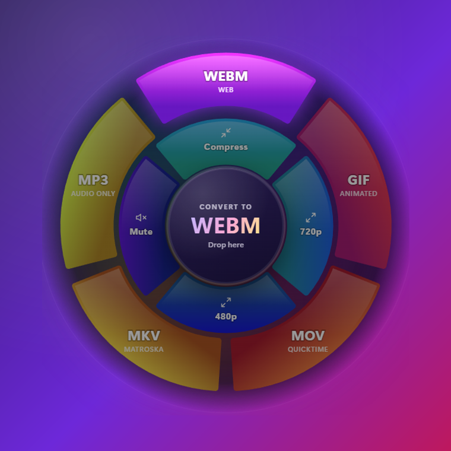

<div align="center">


# DragToConvert

**Drag a file. Drop it on a format. Done.**

A tiny Windows tray app that turns any drag-and-drop in File Explorer into a file conversion.
No windows to open, no menus to dig through, no upload: everything runs locally.

[](https://github.com/Kind3rin/DragToConvert/releases/latest)
[](LICENSE)


[**Download**](https://github.com/Kind3rin/DragToConvert/releases/latest) · [How it works](docs/HOW-IT-WORKS.md) · [Italiano](README.it.md)

</div>

---

## How it feels

1. Start dragging a file in File Explorer (or on the desktop) while holding **Shift**.
2. A **wheel** opens around your cursor:
   - the **outer ring** has the output **formats**,
   - the **inner ring** has quick **tools** (compress, resize, strip metadata...).
3. Drop the file on a slice. A progress ring fills up and a green check appears.
4. The new file is saved **right next to the original**, which is never touched.

Prefer no modifier key? Switch the tray option to *Just drag* and the wheel appears when you pause for a moment mid-drag.

<table>
  <tr>
    <td align="center"><br/><sub>Hover a format to see what you'll get</sub></td>
    <td align="center"><br/><sub>Quick tools sit on the inner ring</sub></td>
  </tr>
  <tr>
    <td align="center"><br/><sub>The wheel adapts to the file type</sub></td>
    <td align="center"><br/><sub>Live progress, also for videos</sub></td>
  </tr>
</table>

## Install

**The easy way**

1. Download `DragToConvert-Setup-x.y.z.exe` from the [latest release](https://github.com/Kind3rin/DragToConvert/releases/latest).
2. Run it. It installs per-user, **no admin rights needed**, and starts right away.
3. Look for the wheel icon in the system tray (you may need to expand the `^` arrow).

> Windows SmartScreen may warn about an unrecognized app because the installer is not code-signed yet.
> Click **More info → Run anyway**. The whole source is in this repository if you want to check or build it yourself.

To start it automatically with Windows, right-click the tray icon and enable **Start with Windows**.

**From source**

```bash
git clone https://github.com/Kind3rin/DragToConvert.git
cd DragToConvert
npm install
npm start
```

Requires [Node.js](https://nodejs.org) 20 or newer. Build your own installer with `npm run dist` (output in `dist/`).

## What it converts

| You drag | Formats ring | Tools ring |
| --- | --- | --- |
| **Images**<br/>JPG, PNG, WEBP, AVIF, GIF, TIFF, BMP, ICO, SVG, HEIC/HEIF | JPG, PNG, WEBP, AVIF, PDF, TIFF, GIF, BMP, ICO | Compress, 50%, 25%, grayscale, rotate, strip EXIF/privacy |
| **Video**<br/>MP4, MOV, MKV, WEBM, AVI, M4V, WMV, FLV, MPEG, 3GP | MP4, WEBM, GIF, MOV, MKV, MP3 (audio only) | Compress, 720p, 480p, mute |
| **Audio**<br/>MP3, WAV, FLAC, OGG, M4A, AAC, OPUS, WMA | MP3, WAV, FLAC, OGG, M4A, OPUS | Compress (MP3 128k), normalize volume, mono |

Good to know:

- Drag **several files at once**: they are converted one after another.
- Animated GIF and WEBP stay animated when converted to each other.
- Transparent images are flattened on white when saved as JPG.
- Output names never overwrite anything: `photo.webp`, then `photo (1).webp`. Tools add a suffix, e.g. `photo (compressed).jpg`.
- Click the green check after a conversion to reveal the result in File Explorer.

## Settings

Right-click the tray icon:

| Option | What it does |
| --- | --- |
| **Enabled** | Pause/resume the app without quitting it |
| **How to show the wheel** | *Shift + drag* (default) or *Just drag (pause for a moment)* |
| **Also work outside File Explorer** | By default the wheel only opens for drags that start in File Explorer or on the desktop |
| **Start with Windows** | Launch at sign-in (installed version) |

The interface follows your Windows language (English or Italian). Force one by adding `"language": "en"` or `"it"` to `%APPDATA%\DragToConvert\settings.json`.

## FAQ

**Is it safe? Does it upload my files?**
Everything is processed locally, nothing leaves your PC. The app makes no network requests. The original file is never moved, modified or deleted: dropping always performs a *copy* operation.

**The wheel doesn't show up.**
Make sure the drag starts in File Explorer or on the desktop, or enable *Also work outside File Explorer*. Apps running as administrator can't be observed by a normal-privilege app: run DragToConvert as administrator too if you need that.

**My antivirus flags it. Why?**
DragToConvert needs a global mouse hook to notice when a drag starts, and that technique is also used by keyloggers, so some security tools are suspicious of unsigned apps that use it. The code is fully open (the hook only reads button state, pointer movement and Shift: see [SECURITY.md](SECURITY.md)). Every release ships a `SHA256SUMS.txt` so you can verify the download (`Get-FileHash "DragToConvert-Setup-x.y.z.exe"`), and you can always build the installer yourself.

**Why does Shift + drag in Explorer normally move files?**
It does, and that's why the wheel is only a drop target: if you release the file anywhere else, Windows behaves exactly as usual.

**Why is the installer ~140 MB?**
It bundles Electron, FFmpeg and the image engine so it works out of the box with no extra downloads.

**HEIC output? PDF to image? Office documents?**
Not yet. See the roadmap below.

## Roadmap

- [ ] Output HEIC, JXL
- [ ] PDF → images, images → single multi-page PDF
- [ ] Audio/video quality presets
- [ ] Custom tools and per-format defaults
- [ ] Code-signed installer (e.g. via a free open-source signing program) and `winget` package
- [ ] More languages

Ideas and pull requests are very welcome: see [CONTRIBUTING.md](CONTRIBUTING.md).

## Under the hood

Electron overlay + a global low-level mouse hook (`uiohook-napi`) to know when a drag starts, `koffi` to peek at the window under the cursor (Win32), `sharp`/libvips for images, `FFmpeg` for audio/video, `pdf-lib` for PDF. The interesting part, how a transparent window can receive an OS drag that started in another app, is explained in [docs/HOW-IT-WORKS.md](docs/HOW-IT-WORKS.md).

## Development

```bash
npm start                      # run (stays in the tray)
npm run demo                   # show the wheel without dragging (--hover=N --mime=video/mp4 --state=busy|done --lang=it)
npm run selftest -- <folder>   # smoke-test the converters (needs pic.png and clip.mp4 in the folder)
npm run screenshots            # regenerate docs/img
npm run dist                   # build the Windows installer
```

## License

[MIT](LICENSE) for the DragToConvert source code. Release binaries bundle third-party components under their own licenses (notably FFmpeg, GPL-3.0): see [THIRD_PARTY_NOTICES.md](THIRD_PARTY_NOTICES.md).
